# Program Flow: Java Multi-Client Messaging System

This document explains how the program runs, from startup to shutdown, and how the server and clients process each feature. File and class names match the source code in `src/`.

---

## 1. Big picture

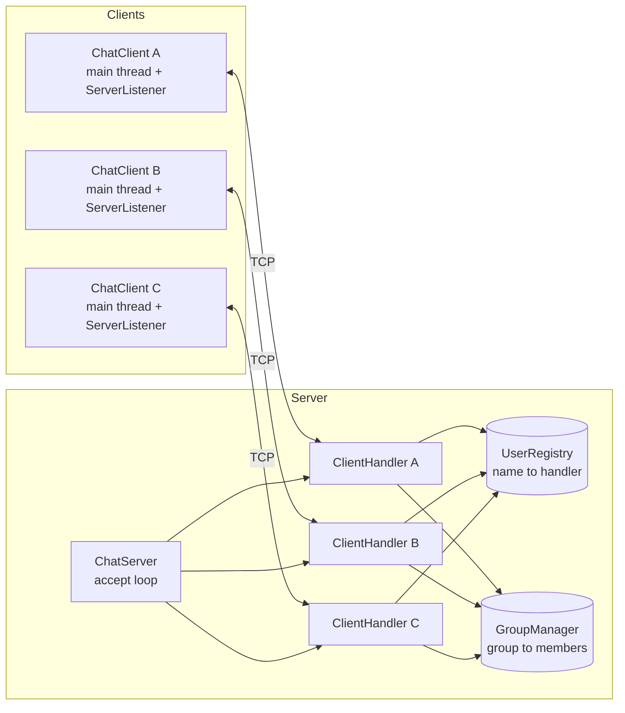

- **One central server**, many clients. Clients never talk to each other directly. Every message goes through the server.
- **One TCP socket per client**, and **one server thread (`ClientHandler`) per client**.
- **Shared state lives only on the server:** online users (`UserRegistry`) and groups (`GroupManager`). Both are in memory only, so they disappear when the server stops.
- **Message history lives only on each client**, in a local file.

### Threads

| Where | Thread | Job |
|---|---|---|
| Server | main | `ServerSocket.accept()` loop; hands each new socket to a thread pool |
| Server | one `ClientHandler` per client | reads that client's frames and processes them |
| Client | main | reads keyboard commands, sends requests |
| Client | `ServerListener` | reads everything the server sends, prints it, saves history, receives files |

The client needs two threads because the user can type at any time while messages arrive at any time.

---

## 2. Wire format: how bytes travel

Every text message is one **frame**:

```
+----------------+--------------------------------------------+
| 4-byte length  |  UTF-8 bytes of  TYPE|SENDER|RECIPIENT|CONTENT |
+----------------+--------------------------------------------+
```

- **Where a message ends:** the receiver reads the 4-byte length (`readInt`), then exactly that many bytes (`readFully`). This is why several messages on one TCP connection never get mixed up.
- **Separator characters in content:** the text is split with `split("\\|", 4)`. Only the first 3 `|` are separators, so the content (the last field) can contain any number of `|`.
- **Names can't contain `|`:** usernames and group names are validated (`Protocol.isValidName`): 1 to 20 letters (including Arabic), digits, `_`, `.`, `-`.
- **Arabic and English:** frames are encoded and decoded as UTF-8 on both sides.
- **Safety limit:** a frame larger than 1 MB is rejected.

### Message types

| Type | Direction | Meaning |
|---|---|---|
| `REGISTER` | client to server | ask for a username |
| `REGISTER_OK` / `REGISTER_FAIL` | server to client | registration result |
| `PRIVATE` | client to server to recipient | private message |
| `PRIVATE_SENT` | server to sender | confirmation that the private message was delivered |
| `GROUP_CREATE` / `GROUP_JOIN` / `GROUP_LEAVE` | client to server | group management |
| `GROUP_MSG` | client to server to all members | group message |
| `LIST_USERS` / `USERS` | client to server, then server to client | online list as `name@ip,name@ip` |
| `FILE_SEND` | client to server to recipient | file header: `filename:size` |
| `FILE_READY` / `FILE_DENIED` | server to sender | permission to start or refuse a file |
| `FILE_RESULT` | receiver to server to sender | `OK:...` or `FAIL:reason` |
| `INFO` / `ERROR` | server to client | status text |
| `QUIT` | client to server | clean disconnect |

---

## 3. Startup

### 3.1 Server startup (`ChatServer.main`)

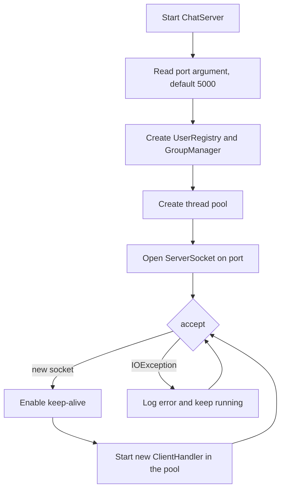

If the port is invalid or already in use, the server prints an error and exits cleanly. A failure on a single `accept()` is logged and the loop continues.

### 3.2 Client startup (`ChatClient.start`)

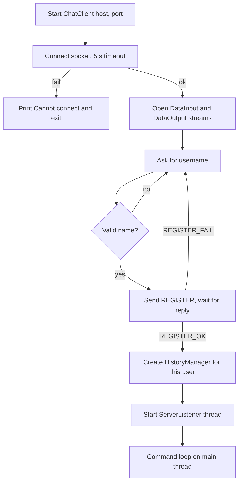

---

## 4. Registration (feature 5)

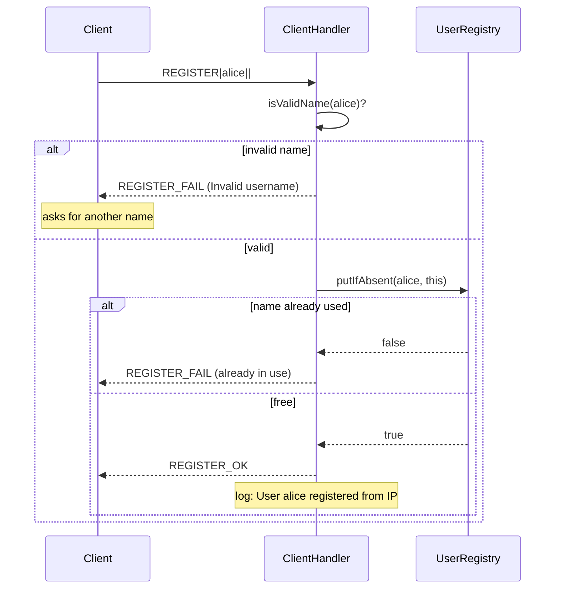

How it is processed:

1. The handler's first loop accepts only `REGISTER` frames. Anything else gets `REGISTER_FAIL: You must register first`.
2. Uniqueness is decided atomically by `ConcurrentHashMap.putIfAbsent`, so two clients choosing the same name at the same moment cannot both win.
3. The handler holds its own write lock while registering and replying, so no other thread can send this client anything before `REGISTER_OK`.
4. The client's IP comes from `socket.getInetAddress().getHostAddress()` and is stored in the handler.
5. The client keeps asking for a username until the server accepts one.

---

## 5. The main loop: how every request is processed

After registration, each `ClientHandler` runs this loop:

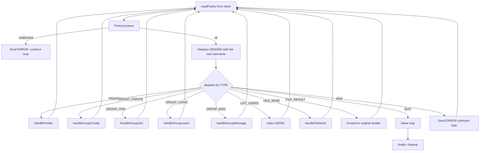

Notes:

- The server **overwrites the sender field** with the username registered on that connection, so a client can't pretend to be someone else.
- Every handler is wrapped in `try/catch/finally`. An error with one client ends only that client's thread. The server and the other clients keep running.

---

## 6. Private messaging (feature 1)

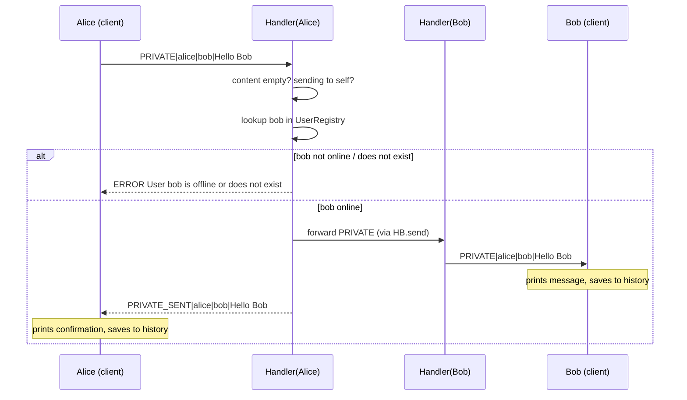

Processing steps:

1. The client builds the frame from `/msg bob Hello Bob`, after checking locally that the name is valid.
2. The server checks for an empty message and for sending to yourself, then looks up the recipient.
3. The message is delivered **only** to the recipient's handler. Nobody else receives it.
4. Only after a successful delivery does the server send `PRIVATE_SENT` back, so the sender's history never contains a message that was not delivered.

---

## 7. Group messaging (feature 1)

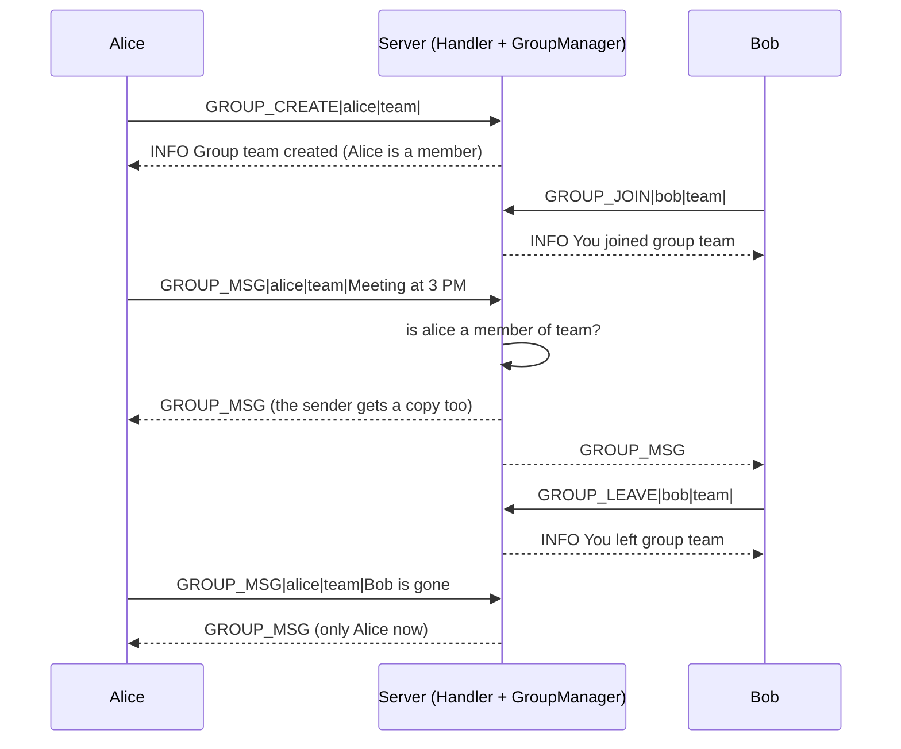

| Operation | Success | Errors |
|---|---|---|
| Create | name is valid and not taken; creator becomes a member | invalid name; group already exists |
| Join | user added to the member set | group does not exist; already a member |
| Leave | user removed from the member set | group does not exist; not a member |
| Group message | forwarded to every current member, **including the sender** | group does not exist; sender is not a member; empty message |

Details:

- `GroupManager` is a map of `groupName to Set<username>`, and its methods are `synchronized` so concurrent joins, leaves and messages stay consistent.
- `members()` returns a **copy** of the set, so the server can iterate and send without holding the lock.
- Once a user leaves, they are no longer in the set, so they stop receiving that group's messages.
- When a client disconnects, `removeUser()` removes them from all groups.
- On the client, group messages are saved to history when they **arrive back from the server**. Since the sender receives a copy too, this avoids saving each message twice.

---

## 8. Online users list (feature 5)

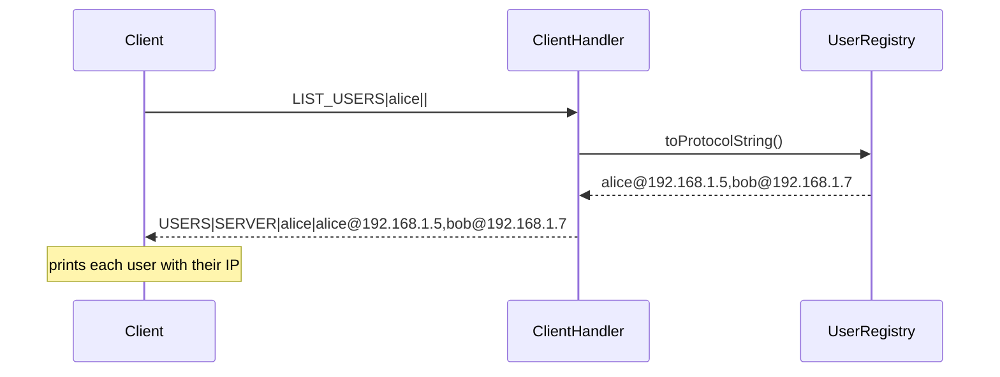

- Each user's IP is the one the server saw on that client's socket when it connected.
- A user is removed from the registry as soon as their handler ends. This covers a clean `/quit` and also crashes, killed processes and network drops.
- The server also logs the online list every time someone joins or leaves.

---

## 9. File transfer (feature 3)

This is the most involved flow, so it is split into phases.

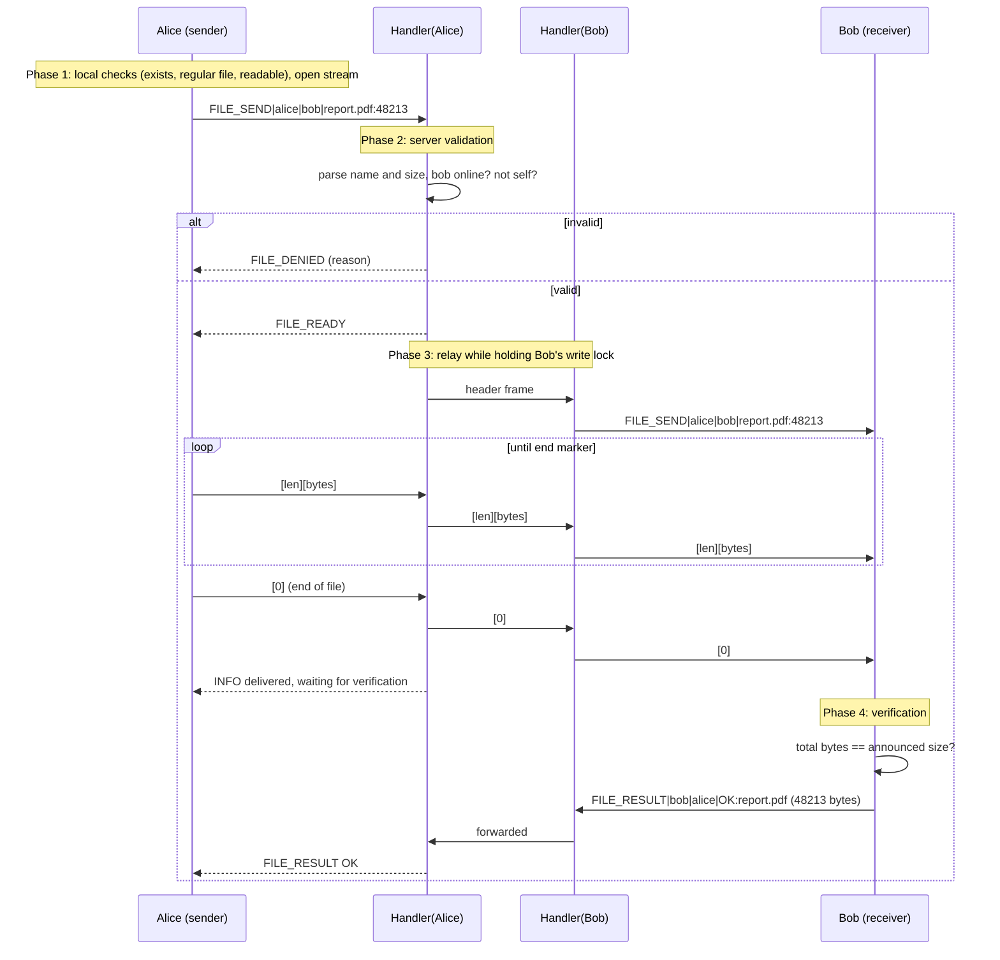

### Phase 1: sender checks (`FileSender`)
The file must exist, be a regular file and be readable. Otherwise an error is printed and **nothing is sent**. The stream is opened before the header is sent, so problems are caught early.

### Phase 2: server validation (`ClientHandler.handleFileSend`)
The server parses `filename:size` (using the **last** `:`, so filenames may contain `:`). It refuses with `FILE_DENIED` if the header is invalid, the size is negative, the recipient is yourself, or the recipient is offline or unknown. The sender waits for `FILE_READY` or `FILE_DENIED` (up to 120 seconds) before sending any file bytes.

### Phase 3: streaming and relay
Raw file bytes are sent in chunks of up to 64 KB:

```
[int len > 0][len raw bytes]   ... repeated
[int 0]                        = end of file
[int -1]                       = transfer aborted
```

- **How the receiver finds the start of the file:** the `FILE_SEND` header frame announces it. Everything after it is chunk data.
- **How the receiver finds the end of the file:** the `0` marker.
- While relaying, the server holds the **recipient's write lock** so no other message (for example a private message from someone else) can be mixed into the middle of the file data. The sender's client also holds its own write lock while streaming.
- If the file can't be read in the middle of sending, the sender transmits `-1`, and the receiver deletes the partial file.
- If the sender's connection drops mid-transfer, the server sends `-1` to the receiver.
- If the receiver disconnects mid-transfer, the server keeps reading the sender's remaining chunks (so the sender's stream stays in sync) and then tells the sender the transfer failed.

### Phase 4: receiver verification (`FileReceiver`)
1. A folder `downloads_<username>/` is created if missing.
2. The filename is sanitized: path parts are removed (prevents path traversal such as `../../x`) and illegal characters are replaced.
3. **Name conflicts:** if `report.pdf` exists, the file is saved as `report(1).pdf`, then `report(2).pdf`, and so on. The file is created atomically, so an existing file is never overwritten.
4. Bytes are written to disk as they arrive.
5. At the end marker, the received byte total is compared with the size announced in the header:
   - equal: verified, and `FILE_RESULT|OK:...` goes to the sender
   - different, aborted, or disk error: the partial file is **deleted** and `FILE_RESULT|FAIL:reason` goes to the sender

---

## 10. Message history and search (feature 2)

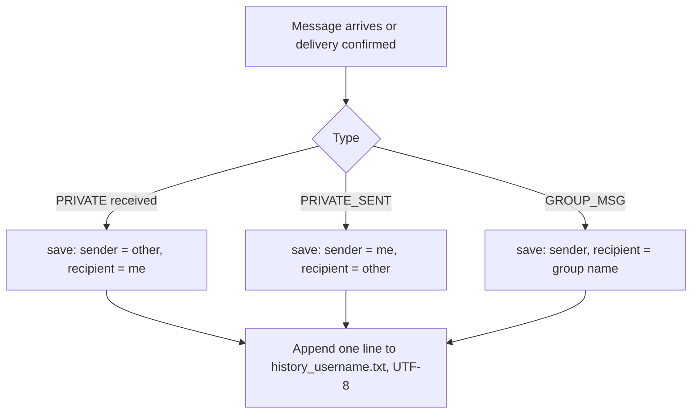

**File format**, one line per message:

```
2026-10-27 18:28:33|PRIVATE|alice|bob|Hello Bob
2026-10-27 18:28:35|GROUP_MSG|alice|team|Meeting at 3 PM
   datetime        | type  |sender|to  | content (newlines escaped)
```

- The file is opened in **append mode**, so history survives closing and restarting the client.
- Each user has their own file (`history_<username>.txt`). The server never stores or searches messages.
- **`/search meeting`** reads the local file, lowercases both sides, and prints every line whose content contains the phrase. This works for Arabic as well.
- **`/history`** prints everything.
- Newlines inside a message are escaped when saved and restored when read, so one message is always exactly one line.

---

## 11. Disconnection and cleanup

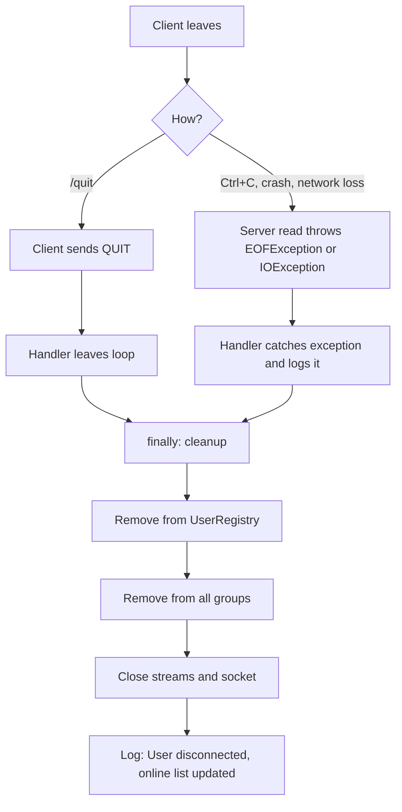

- Cleanup is in a `finally` block, so it runs **every time**, whether the client quit cleanly or vanished.
- **Client side:** if the server goes away, `ServerListener` gets an `IOException`, prints *Disconnected from the server* and exits. If the connection breaks in the middle of receiving a file, the partial file is deleted.

---

## 12. Error handling summary

| Situation | Who detects it | Result |
|---|---|---|
| Server not running / wrong port | client | "Cannot connect to host:port" and exit |
| Username taken or invalid | server | `REGISTER_FAIL`, client asks again |
| Private message to offline or unknown user | server | `ERROR` to sender |
| Group does not exist / not a member / already exists | server | `ERROR` to requester |
| Unknown command or missing arguments | client | usage message, nothing sent |
| Malformed frame | server | `ERROR`, connection stays open |
| Oversized or corrupt frame length | both | `IOException`, that connection is closed |
| File missing, not a file, unreadable | sender client | error printed, nothing sent |
| File recipient offline or invalid | server | `FILE_DENIED` |
| File read error mid-transfer | sender client | abort marker `-1`, receiver deletes the partial file |
| Sender or receiver disconnects mid-transfer | server | abort or error reported, partial file deleted |
| Size mismatch or disk error on receive | receiver | partial file deleted, `FILE_RESULT|FAIL` to sender |
| History file cannot be written or read | client | warning or error printed, program continues |

---

## 13. Concurrency rules (why it is thread-safe)

| Shared resource | Protection |
|---|---|
| `UserRegistry` map | `ConcurrentHashMap`; `putIfAbsent` makes name claims atomic |
| `GroupManager` map and sets | all methods `synchronized`; callers get copies |
| A client's socket output (server side) | per-handler `writeLock`, so frames from different threads never interleave |
| A client's socket output (client side) | `ChatClient.writeLock`, shared by the main thread and the listener (which sends `FILE_RESULT`) |
| File data on a recipient's socket | recipient's `writeLock` held for the whole relay |
| History file | `synchronized` methods in `HistoryManager` |
| Server console log | `synchronized log()` |

---

## 14. Typical session, end to end

1. Start the server. It logs `Server started on port 5000`.
2. Alice starts a client, types `alice`, and receives `REGISTER_OK`. Bob does the same.
3. Alice types `/users` and sees `alice (ip)` and `bob (ip)`.
4. Alice types `/msg bob Hello`. Bob sees `[Private] alice: Hello`. Both histories are updated.
5. Alice types `/create team`, Bob types `/join team`, and Alice types `/gmsg team Meeting at 3 PM`. Both see it.
6. Alice types `/sendfile bob C:\docs\report.pdf`. Bob's file is saved in `downloads_bob/`, verified, and Alice is told it was received.
7. Bob types `/search meeting` and sees the group message from his local history.
8. Bob types `/quit`. The server removes him from the online list and from all groups.
